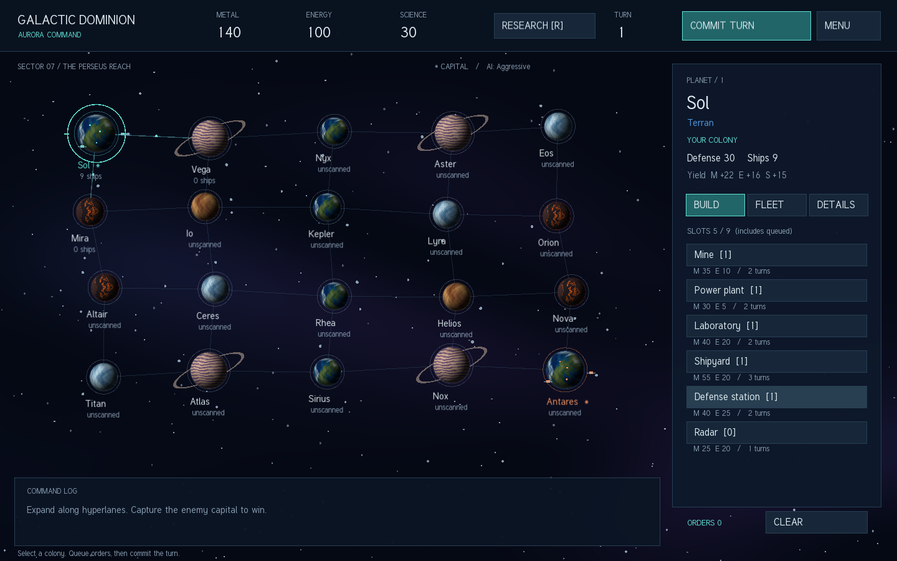

# Galactic Dominion

Небольшая законченная пошаговая космическая стратегия на **C++23 / SFML 3**.
Два соперника одновременно планируют развитие империй и перемещение флотов.
Побеждает тот, кто захватит вражескую столицу. Доступны четыре варианта ИИ
и игра вдвоём по локальной сети.



## Быстрый запуск на macOS

Нужны Command Line Tools (`xcode-select --install`) и CMake 3.28+.

```sh
cmake -S . -B build -DCMAKE_BUILD_TYPE=Release
cmake --build build -j 4
open build/GalacticDominion.app
```

При первой конфигурации CMake загружает закреплённую версию SFML **3.0.2**
и FreeType. Глобальная установка SFML не нужна. При последующих сборках
используется локальная копия. Собранный `.app` содержит текстуры и шрифт;
его можно перенести из каталога сборки.

## Linux

Нужны компилятор C++23 (например GCC 13+) и CMake 3.28+.
Пример зависимостей для Ubuntu 24.04:

```sh
sudo apt-get install build-essential cmake git libx11-dev libxrandr-dev \
  libxcursor-dev libxi-dev libudev-dev libfreetype-dev libgl1-mesa-dev
cmake -S . -B build -DCMAKE_BUILD_TYPE=Release
cmake --build build -j 4
./build/GalacticDominion
```

Рядом с Linux-бинарником должен оставаться каталог `assets/`, который копирует CMake.
Альтернативный путь задаётся `--assets /path/to/assets`.
Официальная справка: [сборка SFML через CMake](https://github.com/SFML/cmake-sfml-project).

## Как играть

1. Выберите доктрину ИИ в главном меню и нажмите **NEW CAMPAIGN**.
2. Выберите свою планету. **BUILD** строит сооружения, **FLEET** — корабли.
3. На вкладке **FLEET** выберите долю флота кнопкой `%`, нажмите **SEND**,
   затем щёлкните соседнюю планету, соединённую гиперлинией.
4. **RESEARCH** открывает три цепочки технологий. Кнопки ниже в цепочке
   становятся доступны после завершения предыдущего исследования.
5. **COMMIT TURN** подтверждает приказы. Пока ход не подтверждён,
   **CLEAR** возвращает зарезервированные ресурсы и снимает все приказы.
6. Захватите столицу противника, отмеченную `*`. При одновременной потере
   обеих столиц объявляется ничья.

| Клавиша | Действие |
|---|---|
| Enter | Подтвердить ход |
| R | Открыть/закрыть исследования |
| Esc | Закрыть окно/отменить выбор цели; затем выйти в меню |
| F5 / F9 | Сохранить / загрузить одиночную партию |
| U | Отменить последний завершённый одиночный ход |

**DETAILS** показывает очередь производства. Недоступные действия затемнены:
проверьте ресурсы, свободные слоты, наличие верфи и нужной технологии.
Подробные правила: [docs/RULES.md](docs/RULES.md).

Сохранение: `~/.galactic-dominion/campaign.save`. Завершённые одиночные ходы
сохраняются автоматически. Сохраняется мир и выбранная доктрина противника;
неподтверждённые приказы и история отмены в файл не входят. Запись идёт во
временный файл с последующим переименованием. **NEW CAMPAIGN** заменит
автосохранение после первого завершённого хода новой партии.

## LAN: два человека

Оба участника запускают одинаковую версию игры.

- Первый нажимает **HOST LAN**; второй вводит IPv4 первого компьютера и **JOIN LAN**.
- Используется TCP-порт **4242**. Для двух процессов на одном компьютере — `127.0.0.1`.
- Хост играет за Aurora, подключившийся игрок — за Ember.
- Каждый независимо планирует и подтверждает ход. Сервер выполняет его после
  подтверждения обоих игроков; клиент получает состояние и события.
- При разрыве соединения отображается сообщение, партия останавливается.
  Для новой сессии оба возвращаются в меню. Переподключение к текущей партии
  и сохранение LAN-партий в этой версии не предусмотрены.

Сеть предназначена для доверенной локальной сети: аутентификации/TLS нет,
сервер отправляет полный снимок мира, а интерфейс скрывает силы вне разведки.
Приказы всё равно проверяются сервером: клиент не может назначить себе другого
игрока, потратить чужие ресурсы или двигать чужие флоты.

## Состав игры и архитектура

- 20 планет, зеркальная связная карта, гарантированно 5 типов планет.
- Металл, энергия, наука; 6 сооружений, 4 класса кораблей, 9 технологий.
- Производственные очереди, содержание флотов, штраф за дефицит энергии.
- Одновременные бои, гарнизоны, осадные корабли, подкрепления, разведка.
- Aggressive, Economic, Defensive и Scientific AI.
- Текстурные планеты, освещение, атмосферы, кольца, спутники, орбитальные
  сооружения, поселения, звёзды, маршруты и боевые эффекты.

| Паттерн | Где | Реальная задача |
|---|---|---|
| Builder | `include/gd/model.hpp` | Разные шаги создания столицы и нейтральной планеты |
| Factory Method | `include/gd/model.hpp` | Создание четырёх видов кораблей через виртуальную фабрику |
| Composite | `include/gd/model.hpp` | Корабль → эскадрилья → армада; рекурсивные боевые параметры |
| Decorator | `include/gd/model.hpp` | Наложение оружия, брони и двигателей |
| Command | `include/gd/game.hpp` | Одни и те же приказы для UI, AI и сети |
| Template Method | `include/gd/game.hpp` | Фиксированный порядок хода с виртуальными этапами |
| Observer | `include/gd/game.hpp` | События для журнала и визуальных эффектов |
| Facade | `include/gd/game.hpp` | Точка входа в игровые подсистемы |
| Memento | `include/gd/game.hpp` | Снимок перед ходом и отмена |
| Strategy | `include/gd/ai.hpp` | Четыре сменные доктрины AI |

Все основные блоки выделены `// Pattern <Name>`. Анализ **всех 15** учебных
примеров, включая причины отказа от лишних паттернов:
[docs/ARCHITECTURE.md](docs/ARCHITECTURE.md).

Ядро (`model`, `game`, `ai`, `serialization`) не зависит от SFML.
`network` отвечает за транспорт; `app` — за отображение и ввод.
Использован SFML Network вместо отдельного Asio, чтобы сохранить одну внешнюю библиотеку.
Исходное задание и примеры сохранены без изменений в `prompt/`.

## Проверка

```sh
ctest --test-dir build --output-on-failure
```

Независимая от графики и сети сборка ядра:

```sh
cmake -S . -B build-core -DGD_BUILD_APP=OFF -DCMAKE_BUILD_TYPE=Debug
cmake --build build-core -j 4
ctest --test-dir build-core --output-on-failure
```

Для ASan/UBSan добавьте `-DGD_SANITIZE=ON` при конфигурации.
Для визуального сценария (требуется дисплей):

```sh
mkdir -p /tmp/gd-ui-qa
# macOS
./build/GalacticDominion.app/Contents/MacOS/GalacticDominion --ui-test /tmp/gd-ui-qa
# Linux
./build/GalacticDominion --ui-test /tmp/gd-ui-qa
```

Сценарий проверяет обработчики строительства, кораблей, перемещения,
исследования, завершения/отмены хода и меню; сохраняет 6 снимков экранов.
`--smoke-test /tmp/galaxy.png` делает один снимок карты и закрывает приложение.

Фактически выполненные проверки и границы проверки:
[docs/VERIFICATION.md](docs/VERIFICATION.md). Точка продолжения разработки:
[PROGRESS.md](PROGRESS.md). Лицензии изображений и шрифта:
[assets/LICENSE.md](assets/LICENSE.md).
